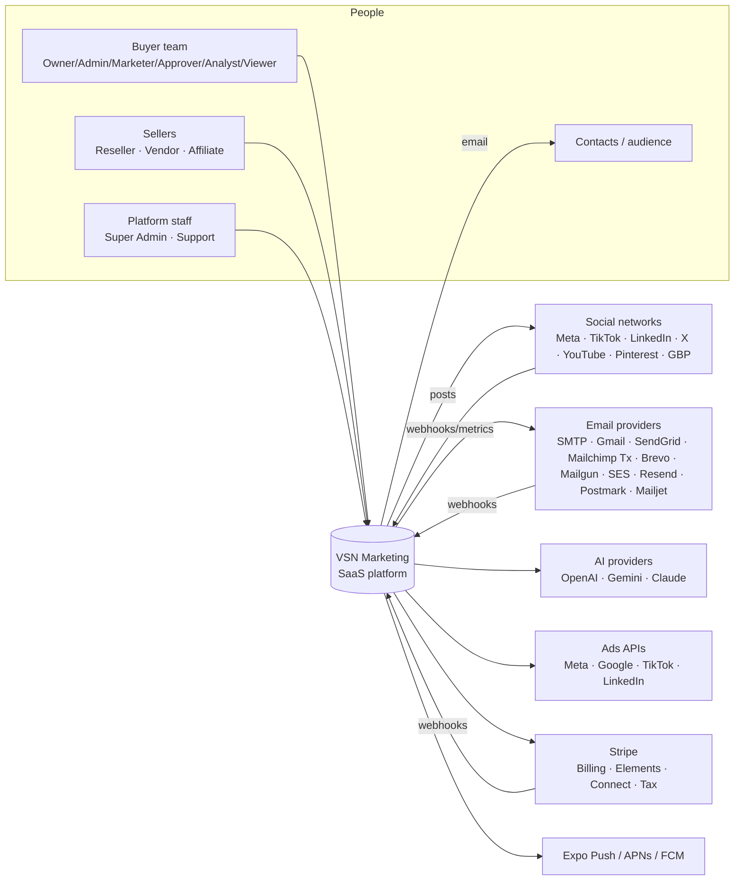
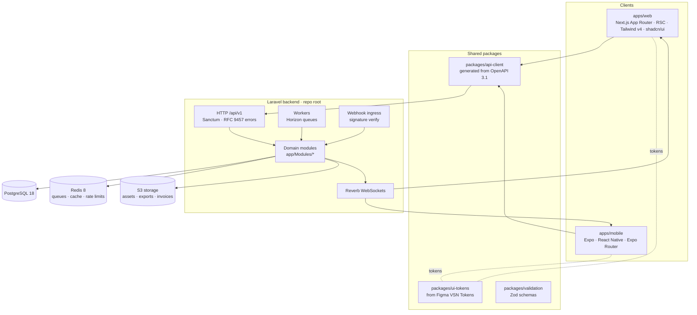
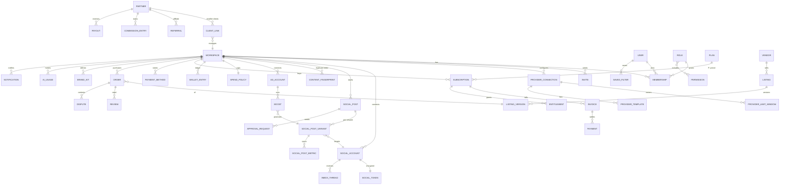
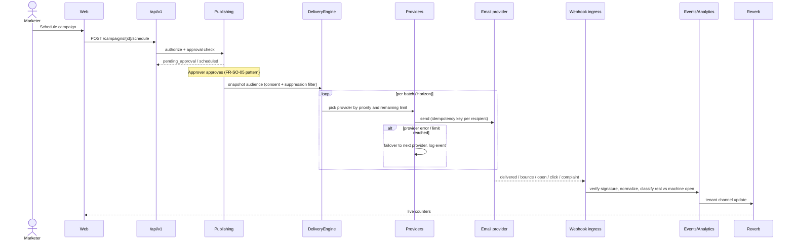
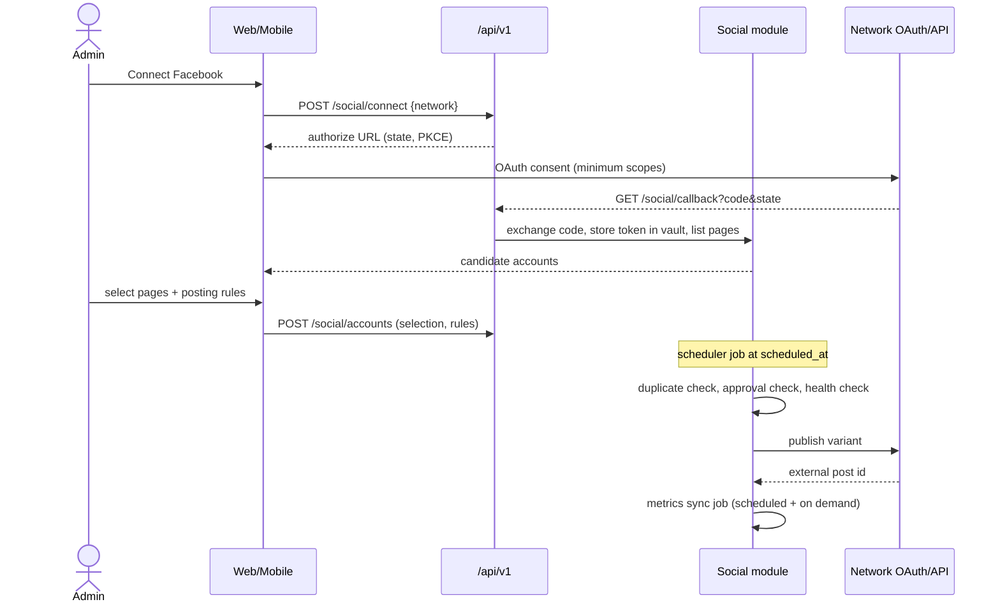
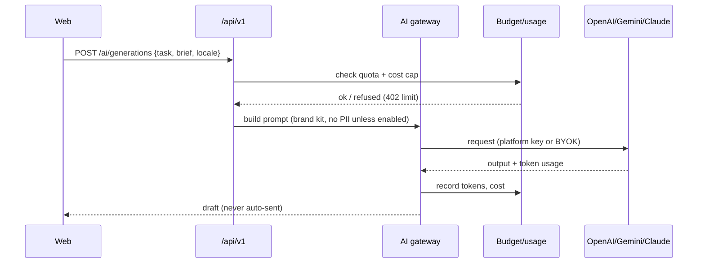
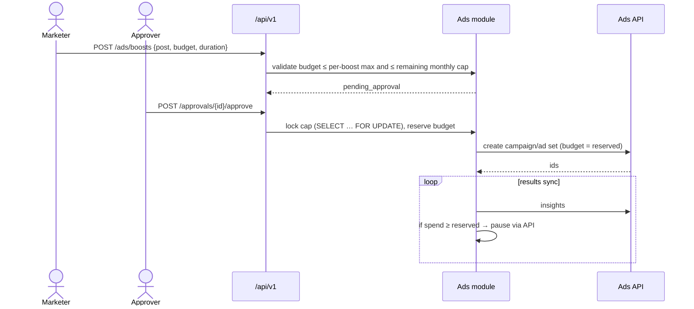
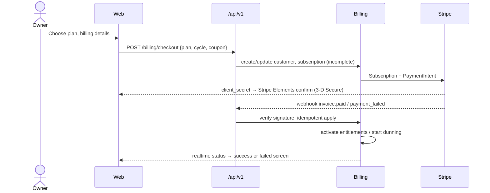
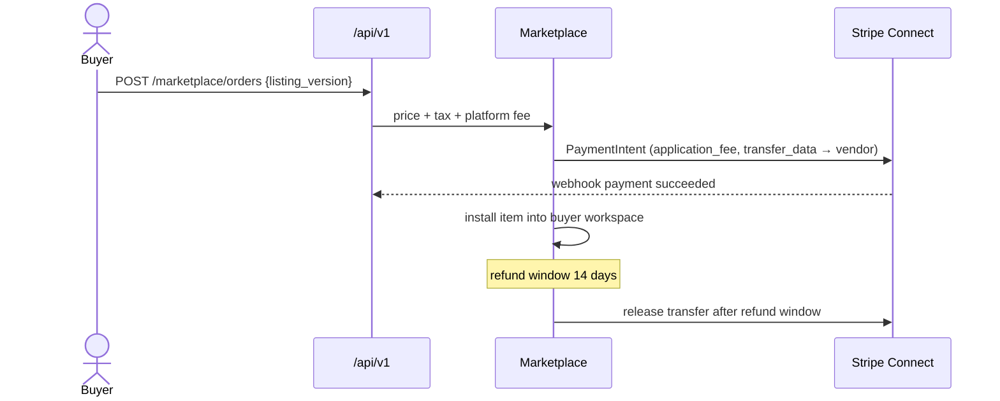

# VSN Marketing — Product-track architecture

| Field | Value |
|---|---|
| Version | 1.0 — 2026-10-17 |
| Owner task | TASK-0146 |
| Inputs | [SRS](SRS.md), [PRODUCT-TRACK-PLAN §2](../../.ai/roadmap/PRODUCT-TRACK-PLAN.md), [01-MASTER-ARCHITECTURE](../../.ai/01-MASTER-ARCHITECTURE.md), [03-DATA-MODEL](../../.ai/03-DATA-MODEL.md), [04-INTEGRATION-STANDARD](../../.ai/04-INTEGRATION-STANDARD.md) |
| Decisions | [ADR-0008](../../.ai/adr/ADR-0008-product-track-architecture.md) |
| API design | [API-V1.md](API-V1.md) |

## 1. System context (C4 level 1)

## 2. Containers (C4 level 2)

Deployment:
- Next.js runs on Vercel or as a container.
- Laravel API, workers and Reverb run as containers (Docker), with managed PostgreSQL and Redis.
- Mobile ships through EAS.

Every environment has its own provider keys. Demo and preview environments only use sandbox adapters.

## 3. Module boundaries

Existing certified modules (`app/Modules/*`) are kept. New product modules follow the same layout:
- `Domain` (entities, rules)
- `Application` (use cases)
- `Infrastructure` (persistence, adapters)
- `Http` (controllers, resources)

A module touches another module's tables only through that module's application services or events, never directly.

| Module | Status | Owns | SRS |
|---|---|---|---|
| Core | existing | tenancy context, outbox, clock, idempotency | C-04 |
| Identity | existing + extend | users, workspaces, memberships, roles, permissions, sessions, SSO, invites | FR-IAM-* |
| Audit | existing | append-only audit events | FR-AU-01 |
| Consent | existing | consent records and lawful basis | C-03 |
| Contacts | existing | contacts, lists, tags, custom fields, imports | FR-EM-10 |
| Segmentation | existing | segment definitions and versions | FR-EM-12 |
| Providers | existing + extend | provider connections, credentials vault, limits, health, failover policy | FR-EM-01..03 |
| DeliveryEngine | existing | snapshots, admission, recovery, suppression, deliverability | FR-EM-04, FR-EM-15 |
| Templates / Content / Assets | existing + extend | templates, blocks, provider template imports, media | FR-EM-06/07 |
| Journeys | existing | automations runtime | FR-EM-13 |
| Experiments | existing | A/B tests | FR-EM-14 |
| Events | existing | customer and engagement events | FR-EM-08/09 |
| Analytics | existing + extend | facts, reports, schedules, exports | FR-RP-* |
| Publishing | existing + extend | campaigns, schedules, publication attempts | FR-EM-05 |
| AI | existing + extend | gateway, budgets, memories, provider adapters, brand kit | FR-AI-* |
| **Social** | new | social accounts, tokens, posts, variants, calendar, approvals, duplicate index, inbox, metrics | FR-SO-* |
| **Ads** | new | ad accounts, boosts, caps, wallet ledger, results | FR-AD-* |
| **Billing** | extend (billing tables exist) | plans, subscriptions, invoices, payment methods, dunning, entitlements | FR-BL-* |
| **Partners** | extend (agency client tables exist) | reseller clients, white-label, commissions, affiliates, referrals | FR-RS-* |
| **Marketplace** | new | vendors, listings, versions, orders, reviews, disputes, payouts | FR-MK-* |
| **Demo** | new | demo tenants, seeders, sandbox adapters, reset | FR-DEMO-* |
| **Notifications** | new | in-app/push/email notifications, preferences | FR-SHL-01, FR-MB-02 |
| **Search** | new | global search index (PostgreSQL FTS) and saved filters | FR-FL-* |

## 4. Data model (new and extended entities)

All tables carry `tenant_id` (except platform-level tables marked P), `created_at`, `updated_at` and soft-delete where noted. IDs are ULIDs. Money is stored as integer minor units plus an ISO 4217 currency.

Key fields and invariants:

| Entity | Key fields | Invariants |
|---|---|---|
| provider_connections | kind, label, credentials_ref (vault), priority, status, last_test_at | Credentials never leave the vault in plaintext; `priority` is unique per tenant |
| provider_limit_windows | window (sec/hour/day/month), limit, used, resets_at | `used` never exceeds `limit` (atomic Redis counter, reconciled to PG) |
| social_accounts | network, external_id, name, scopes[], health, token_expires_at | One tenant cannot attach an `external_id` already held by another tenant without proof of admin (the OAuth result) |
| social_posts / variants | body, media[], locale, status (draft → pending_approval → scheduled → publishing → published / failed), scheduled_at | Publish requires an approved request when policy demands one |
| content_fingerprints | simhash64, media_phash, network, posted_at | Used by the duplicate checker (Hamming distance ≤ 6 = near duplicate) |
| ad_accounts / boosts | budget_minor, currency, starts_at, ends_at, status | The sum of committed boost budgets must stay ≤ the remaining cap (checked in a transaction) |
| spend_policies | monthly_cap_minor, per_boost_max_minor, approver_role | Enforced server-side before any ads API call |
| wallet_entries | type (top_up, spend, refund), amount_minor, balance_after_minor, external_ref | Append-only double-entry; balance is never negative |
| plans (P) | code, prices[], limits{}, trial_days, active | Changes create a new version; existing subscriptions keep their version |
| subscriptions | plan_version, status (trialing, active, past_due, paused, canceled), period_end, stripe_id | One active subscription per workspace |
| entitlements | key, limit, used | Read by the limit guard (FR-BL-06) |
| partners (P) | type (reseller, affiliate), stripe_connect_id, status | Payouts only after Connect verification |
| vendors / listings | type, price_minor, status (draft, in_review, live, suspended) | Listing goes live only after moderation |
| orders | listing_version, amount_minor, fee_minor, refund_until, status | Payout is released after `refund_until` |
| notifications | channel (in_app, push, email), type, read_at | Respect user preferences and quiet hours |

Retention follows SRS NFR-PRV-02.

## 5. Data flows (sequence diagrams)

### 5.1 Email campaign send and tracking (FR-EM-04..09)

### 5.2 Social connect and publish (FR-SO-01..07)

### 5.3 AI generation (FR-AI-01..07)

### 5.4 Ad boost with caps (FR-AD-02/03)

### 5.5 Subscription checkout (FR-BL-02..05)

### 5.6 Marketplace purchase and payout (FR-MK-01..03)

## 6. Cross-cutting design

| Concern | Design |
|---|---|
| Tenancy | A `tenant_id` global scope is applied to every tenant model, and `TenantContext` is resolved per request or job. Cross-tenant test suite on every code PR (NFR-SEC-03) |
| Authorization | Permission catalog plus role policies; approval gates sit in application services, not controllers |
| Idempotency | `Idempotency-Key` header on POSTs that create money, send, publish or spend actions; outbox pattern for events |
| Secrets | Envelope-encrypted credential vault (per-tenant data key); key rotation command |
| Rate limits | Redis token buckets per tenant, per provider connection and per user |
| Realtime | Reverb private channels `tenant.{id}` and `user.{id}`; events are thin (IDs and counters) |
| Search | PostgreSQL `tsvector` columns and a `search_documents` table; Meilisearch only if NFR-PERF targets fail |
| i18n | Backend returns message keys and locale-aware formatting hints; translations live in clients |
| Observability | Request ID and tenant ID in every log line; Sentry; queue metrics in Horizon |
| Demo/sandbox | Adapter registry chooses `Sandbox*` adapters when the tenant is a demo tenant or live mode is off (C-02) |

## 7. Integration catalogue

| Integration | Adapter | Auth | Inbound | Limits handled |
|---|---|---|---|---|
| SMTP / Google SMTP | `SmtpTransport` | user/pass or OAuth2 XOAUTH2 | — (bounce mailbox optional) | per-connection rate config |
| SendGrid | `SendGridAdapter` | API key | Event Webhook (signed) | plan daily limit, 429 backoff |
| Mailchimp Transactional | `MandrillAdapter` | API key | webhooks (signed) | hourly quota |
| Brevo / Mailgun / SES / Resend / Postmark / Mailjet | one adapter each | API key / IAM | provider webhooks / SNS | provider quotas |
| Meta (Facebook, Instagram) | `MetaGraphAdapter` | OAuth (Facebook Login for Business) | webhooks (X-Hub-Signature-256) | app/page rate limits |
| TikTok, LinkedIn, X, YouTube, Pinterest, GBP | one adapter each | OAuth 2 + PKCE | webhooks where offered, else polling | per-network quotas |
| OpenAI / Gemini / Claude | `OpenAIAdapter`, `GeminiAdapter`, `AnthropicAdapter` | API key (platform/BYOK) | — | tokens per minute, cost caps |
| Meta Marketing / Google Ads / TikTok Ads / LinkedIn Ads | one adapter each | OAuth | — | spend caps (internal) |
| Stripe Billing, Elements, Connect, Tax | `StripeGateway` | secret key + webhook secret | webhooks (signed) | idempotency keys |
| Expo Push | `ExpoPushNotifier` | access token | receipts | batch of 100 |

Each adapter implements a provider-neutral interface, a `Sandbox` twin and a contract test. Research tasks (TASK-0109, 0117, 0123, 0127, 0131, 0140) confirm the current API versions before implementation.
